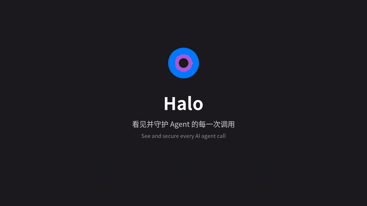

<div align="center">

# Halo

### The local-first observability & security plane for AI agents

给任何 AI Agent 装上「飞行记录仪 + 安全气囊 + 控制台」。

[](https://github.com/zfxzfxzfx852/halo/actions/workflows/ci.yml)
[](./LICENSE)
[](https://go.dev)


</div>

---

[English](#english) | [中文](#中文)

## 中文

Halo 是一个本地优先、自托管的 AI Agent 可观测与安全控制平面。它透明地拦截 Agent 与模型/工具之间的每一次调用，让你实时看见 Agent 在做什么，并在危险操作发生前拦截、审批或隔离执行。

### 特性

- **零侵入**：不改 Agent 代码，透明代理 MCP（stdio/SSE/HTTP）与 OpenAI 兼容 API
- **实时可观测**：调用流 + 调用图谱，风险一目了然
- **策略管控**：声明式 allow / deny / 人工审批
- **安全检测**：prompt injection、jailbreak、PII 与密钥识别脱敏
- **隔离执行**：高危命令在沙箱中运行
- **审计回放**：防篡改哈希链，会话可完整回放
- **本地优先**：数据不出本机，支持 Ollama 本地模型，默认零遥测

### 快速开始

```bash
# 一键安装（macOS / Linux）
curl -fsSL https://raw.githubusercontent.com/zfxzfxzfx852/halo/main/scripts/install.sh | sh

# 交互式生成配置（设置上游、端口、模式）
halo init

# 启动
halo
```

从源码构建：`make build && ./bin/halo`

打开控制台：`http://127.0.0.1:8787/console/`
健康检查：`curl http://127.0.0.1:8787/healthz`

也可用 Homebrew（`brew install zfxzfxzfx852/tap/halo`）或 Docker（`docker compose up -d`）。

### 接入你的工具

把工具的 Base URL 指向 Halo 即可，详见接入指南：

- [Claude Code](./docs/integrations/claude-code.md)
- [Cursor](./docs/integrations/cursor.md)
- [Cline](./docs/integrations/cline.md)
- [通用 MCP 客户端](./docs/integrations/mcp.md) · [接入总览](./docs/integrations/README.md)

### 工作原理

```
Agent ─► Halo 透明代理 ─► 策略/检测/沙箱 ─► 模型/工具
              │
              ▼
      事件存储 + 审计链 + WebSocket + 实时控制台
```

### 文档

- 开发路线图：[`ROADMAP.md`](./ROADMAP.md)
- 发布与运营计划：[`GITHUB_PLAN.md`](./GITHUB_PLAN.md)
- 接入指南：[`docs/integrations/`](./docs/integrations/README.md)

### 合规声明

Halo 仅用于防御、可观测与授权环境，禁止用于未授权攻击。检测样本来自公开靶场与授权数据。

## English

Halo is a local-first, self-hosted observability and security plane for AI agents. It transparently intercepts every call between an agent and its models/tools, visualizes activity in real time, and blocks, approves, or sandboxes risky operations before they run.

### Features

- Non-invasive transparent proxy for MCP (stdio/SSE/HTTP) and OpenAI-compatible APIs
- Real-time call stream and interactive call graph
- Declarative policies: allow / deny / human approval
- Prompt injection, jailbreak, PII and secret detection
- Sandboxed execution for high-risk commands
- Tamper-evident audit chain with session replay
- Local-first, zero telemetry by default, Ollama friendly

### Quick Start

```bash
# one-line install (macOS / Linux)
curl -fsSL https://raw.githubusercontent.com/zfxzfxzfx852/halo/main/scripts/install.sh | sh

# interactive config wizard, then start
halo init
halo
```

Build from source: `make build && ./bin/halo`
Console: `http://127.0.0.1:8787/console/`

Also available via Homebrew (`brew install zfxzfxzfx852/tap/halo`) and Docker (`docker compose up -d`).

### Integrations

Point your tool's Base URL at Halo. See [docs/integrations](./docs/integrations/README.md) for Claude Code, Cursor, Cline and generic MCP clients.

### License

[MIT](./LICENSE)
